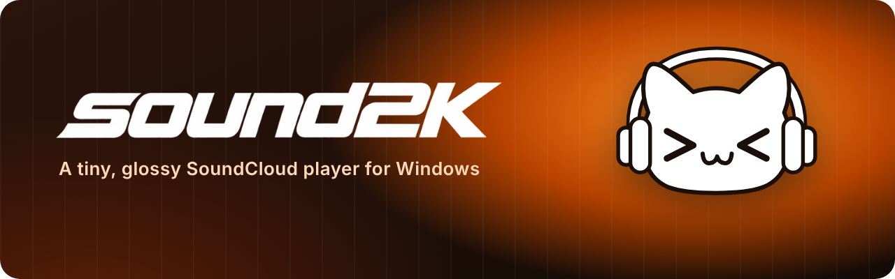
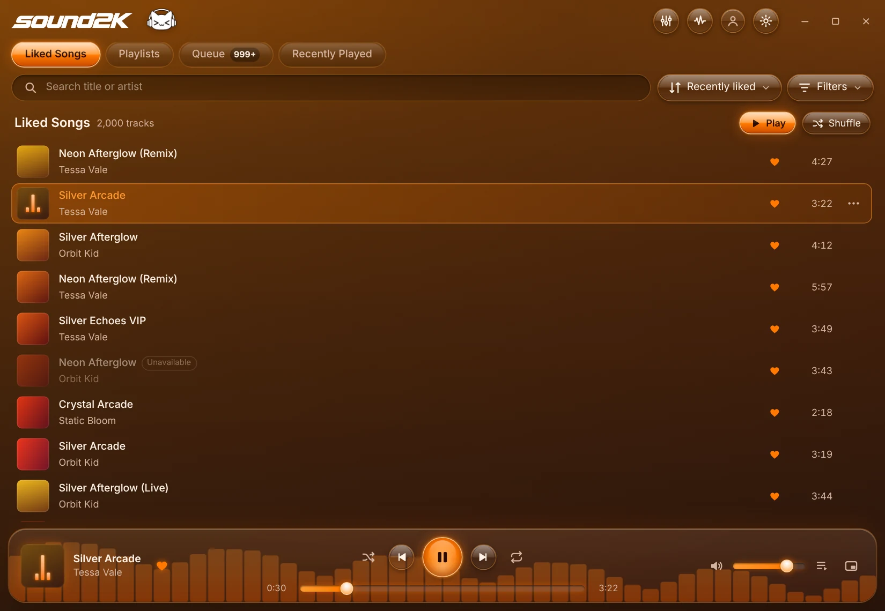
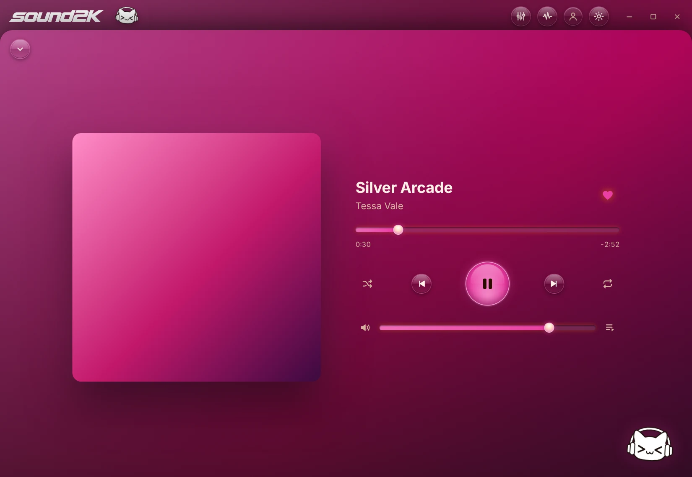
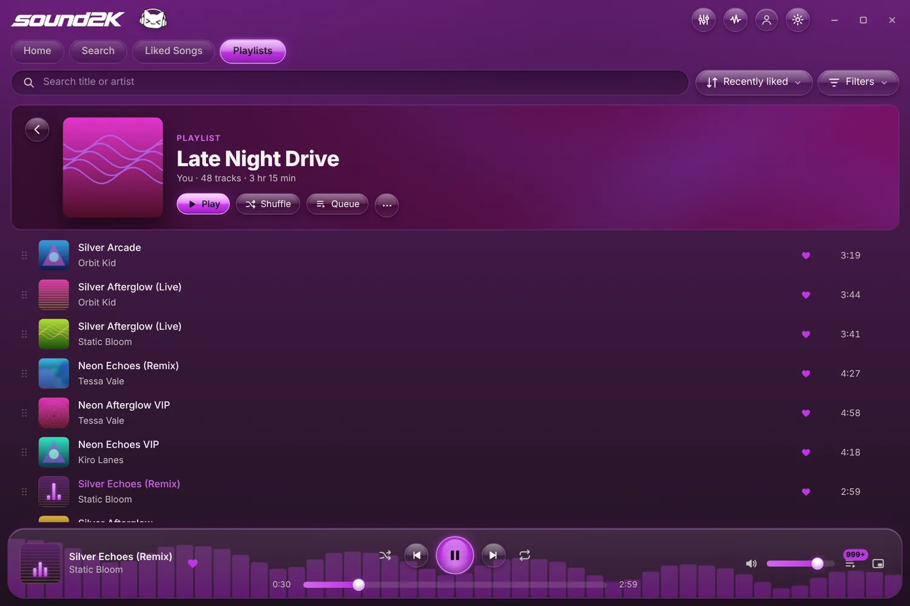
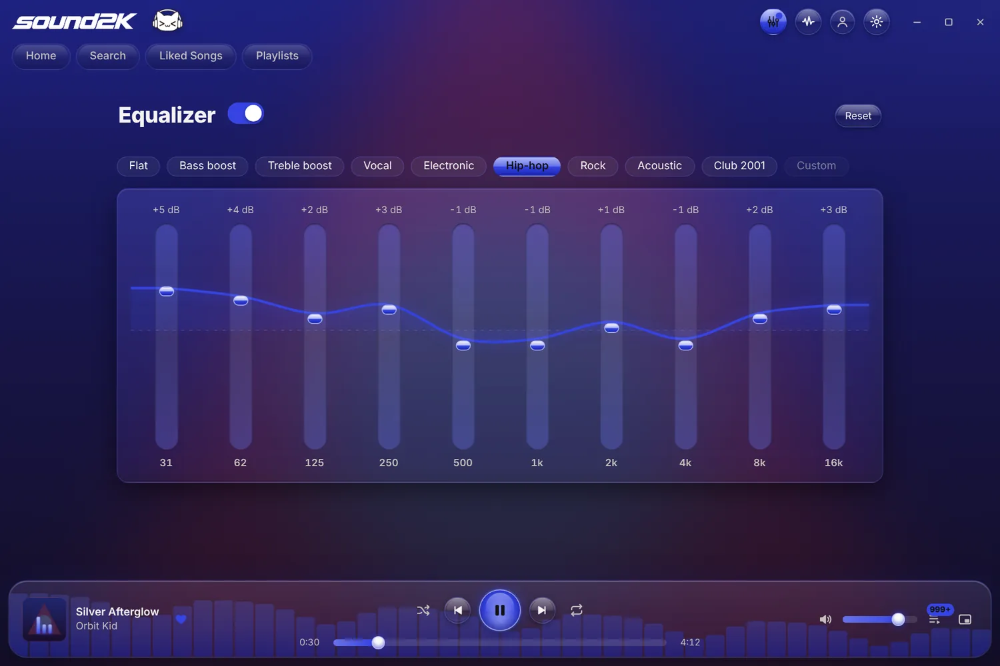
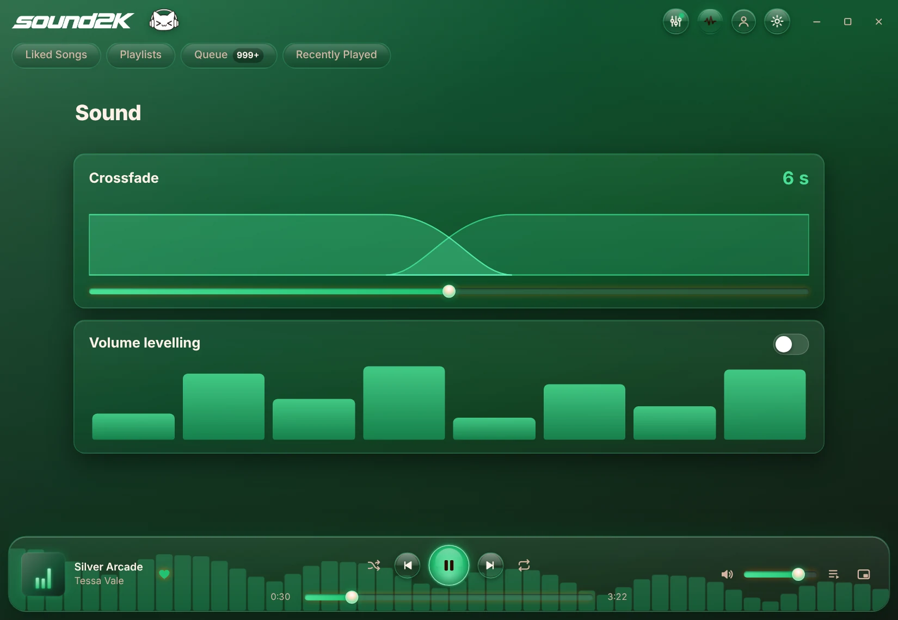
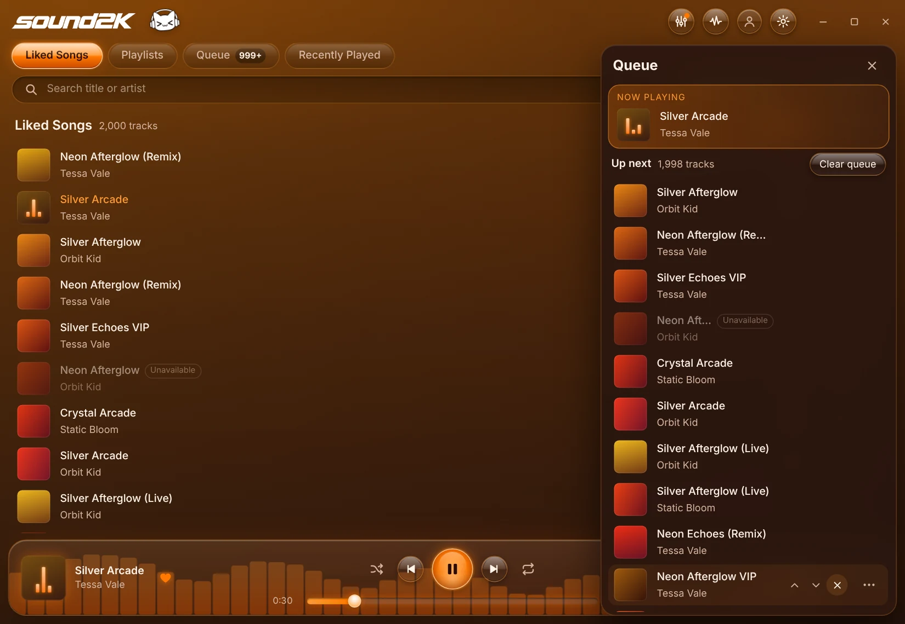
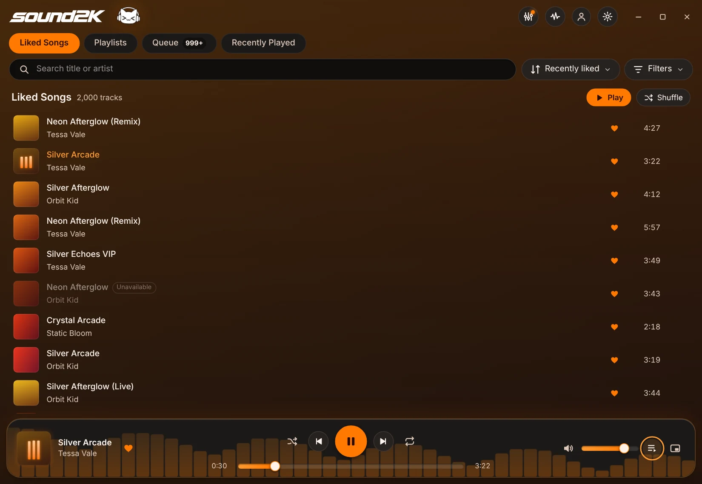
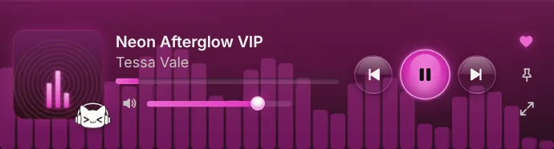

<p align="center">
  
</p>

<p align="center">
  <b>Your SoundCloud likes and playlists in a small, fast, Y2K-glass desktop player.</b><br>
  Colours that follow every song, a mini-player that stays out of your games, and a cat that dances along.
</p>

<p align="center">
  
  
  
  
</p>

<p align="center">
  
</p>

---

## Features

**🎧 Listening**
- Your **Liked Songs**, **Playlists**, **Queue** and **Recently Played**, with instant search, sorting and filters, even with thousands of tracks
- **Crossfade** (up to 12 s), **volume levelling**, and a **10-band equalizer** with presets
- **Autoplay** keeps the music going with similar tracks when your queue ends
- Picks up where you left off: queue and position are restored on launch

**✨ Look & feel**
- **Song colours:** buttons, sliders, glows and the visualizer take on the colour of the current cover, and fade into the next one
- **Now Playing** full-window view with big artwork on a blurred backdrop
- Apple Music-style touches: playlist headers, slide-out queue, springy buttons, scrolling titles
- **Glass** and **Dark** themes, plus a live **visualizer**
- **The cat** 🐱: dances to the bass, naps when you pause, throws hearts when you like a song

**🎮 Made for gaming**
- **Mini-player** that pins on top and **never steals focus** from your game
- **Ctrl+Alt+L** locks it so clicks pass straight through to the game
- Windows **media keys** and the volume-flyout controls work

**🛠 Your library**
- **Like / unlike**, **create, rename and delete playlists**, add, remove and reorder tracks
- **Jump to the playing song** in any list (Ctrl+J)
- **Discord status:** "Listening to …" with cover art and a *Listen on SoundCloud* button (opt-in)
- **Download** tracks whose artist allows it, via SoundCloud's official download

## Screenshots

| Now Playing | Playlist |
|---|---|
|  |  |
| **Equalizer** | **Crossfade & levelling** |
|  |  |
| **Queue slide-out** | **Dark theme** |
|  |  |

<p align="center">
  <b>Mini-player</b><br>
  
</p>

<sub>Screenshots use the built-in sample library; with your account you'll see your real covers.</sub>

## Install

1. Go to **[Releases](../../releases/latest)** and download `Sound2K_x.y.z_x64-setup.exe`.
2. Run it. It installs **for your user only**: no admin rights, no startup entries.
3. Windows SmartScreen may say *"Windows protected your PC"* because the installer isn't code-signed. Click **More info → Run anyway**.

Requires Windows 10 or 11 with the WebView2 runtime (already included in Windows 11 and up-to-date Windows 10).

## Getting started

Open **Settings** (gear icon) → **Sign in to SoundCloud**. A separate window opens SoundCloud's own sign-in page; it closes by itself once you're in.

| Shortcut | Does |
|---|---|
| **Space** | Play / pause |
| **Ctrl + → / ←** | Next / previous |
| **Ctrl + F** | Search |
| **Ctrl + J** | Jump to the playing song |
| **Esc** | Close Now Playing / the queue |
| **Ctrl + Alt + L** | Lock / unlock the mini-player (click-through) |
| **Double-click** a track | Play it |

## Privacy & security

- **No telemetry, no analytics, no accounts other than SoundCloud.**
- Your sign-in is stored in **Windows Credential Manager**, never in a file. Sound2K never reads your browsers or their saved logins.
- Songs stream **into memory only** and are never saved to disk. App data (settings, cache, history) lives in `%LOCALAPPDATA%\Sound2K`, and the artwork cache is capped at 50 MB.
- The app only talks to SoundCloud (and, if you turn it on, the **Discord app on your PC**). Requests to anything else are refused in code.
- The window runs under a strict Content Security Policy with minimal Tauri permissions; the sign-in window gets none.

## Build from source

You'll need **Rust** (stable), **Node.js** 20.19+ / 22.12+, and the **Microsoft C++ Build Tools** ("Desktop development with C++").

```powershell
npm install
npm run tauri dev      # run in development
npm run tauri build    # build the installer
```

The installer appears in `src-tauri\target\release\bundle\nsis\`. Rust unit tests: `cd src-tauri; cargo test`.

<details>
<summary><b>Releasing an update</b></summary>

1. Bump the version in `package.json`, `src-tauri/Cargo.toml` and `src-tauri/tauri.conf.json`.
2. Commit, tag and push:
   ```powershell
   git commit -am "Sound2K 0.2.0"
   git tag v0.2.0
   git push; git push --tags
   ```
3. GitHub Actions builds the installer (~15 min) and creates a **draft** release. Check it under *Releases* and press **Publish**.

</details>

<details>
<summary><b>Project layout</b></summary>

```
ui/                 frontend: plain TypeScript + CSS, no framework (Vite)
  src/components/   dock, mini-player, Now Playing, mascot, visualizer, …
  src/views/        liked, playlists, queue, recent, equalizer, sound
src-tauri/          Rust backend (Tauri 2)
  src/player/       streaming, decoding (symphonia), DSP, playback (rodio)
  src/soundcloud/   SoundCloud client
  src/auth/         sign-in window + Credential Manager
  src/discord.rs    Discord status over local IPC
docs/               README images
```

</details>

## Disclaimer

Sound2K is an independent, unofficial project. It is **not affiliated with or endorsed by SoundCloud** or Discord. SoundCloud only offers its official API to Artist Pro subscribers, so Sound2K uses the same internal API as soundcloud.com. It may break when SoundCloud changes things, and it's intended for personal use. It never plays encrypted (Go+) streams and only downloads tracks their artists made downloadable.

<p align="center">
  <br>
  <sub>made with ♪ and a cat</sub>
</p>
